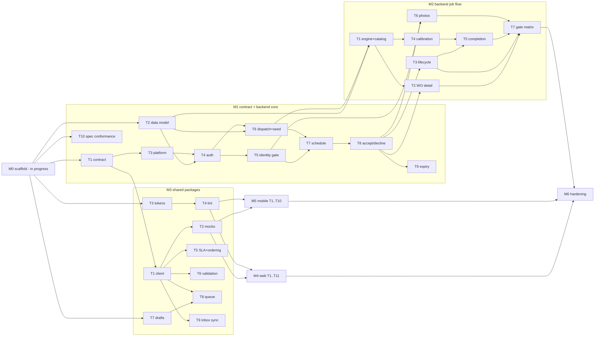

# InsmartFix v1 — Implementation Plan (S2)

**Version:** 1.0 · **Date:** 2026-11-02 · **Stage:** S2 Plan (automated; follows G1 approval of the spec with D1–D10 as recommended)
**Inputs:** [`INSMARTFIX_V1_SPEC.md`](../specs/INSMARTFIX_V1_SPEC.md) (FR/NFR IDs, §5 contract, §4 architecture), [`TEST_PLAN.md`](../testing/TEST_PLAN.md) (§6 test IDs), [`DEVELOPMENT_PROCESS.md`](../process/DEVELOPMENT_PROCESS.md) (§2 PR gate, §4 milestones), [`INSMARTFIX_PRODUCT_DESIGN.md`](../design/INSMARTFIX_PRODUCT_DESIGN.md).

---

## 0 · How to read this plan

- **Task ID** `M<n>-T<k>`. One task = one PR on branch `feat/m<n>-t<k>-<slug>` (the `feat/<milestone>-<task>` convention), ≤ ~400 changed lines excluding generated code (`packages/contracts/openapi.json`, the generated TS client, lockfiles, Alembic autogen boilerplate, screenshot baselines).
- **Start after** = code dependencies; the task can be developed once these are on `main`.
- **Merge after** = extra dependencies needed only for the PR's *live* tests (Playwright/Maestro against the compose stack). UI tasks can be built and component-tested against the `DATA_SOURCE=mock` MSW layer as soon as their *Start after* tasks land, and merge once the backend endpoints their live tests exercise are on `main`.
- **Tests** are TEST_PLAN §6 IDs the PR must add (named `T_AREA_N` / `T-AREA-N` in the test name) and make pass, for the platform letters shown (A=API, W=web, D=Android, I=iOS, core=`packages/core`). A test ID listed on several tasks is split by platform or by layer; the coverage table in §9 shows which task owns which slice.
- **Owner** is the authoring agent. Review gates from DEVELOPMENT_PROCESS §2 apply to every PR; tasks marked **SEC** require the security-reviewer gate, tasks marked **UX** require the ux-designer design-compliance gate.
- Paths below are relative to the package roots M0 creates (e.g. `apps/api/app/…`). If M0 settles on a different root, the module names and boundaries in this plan still hold.

### Architectural rules every task follows
1. **Contract is the boundary.** Any change to request/response shapes edits the Pydantic schemas in `apps/api/app/contract/`, re-exports `packages/contracts/openapi.json`, regenerates the TS client in the same PR, and stays backward-compatible within `/v1` (additive only). CI drift check (M0) fails otherwise.
2. **One authorization path.** Every `/contractor/*`, `/me/*` and `/workorders/*` route calls `identity_gate.authorize()` before touching data. No route does its own principal-vs-resource check. `/me/*` aliases resolve `contractor_id` from the token and call the same handler as `/contractor/{cid}/*`.
3. **Append-only memory.** `memory_events` is written only through `memory.MemorySeam.append()`. The app DB role has `INSERT, SELECT` only (no `UPDATE`/`DELETE`), enforced by migration grants and tested (T-MEM-1).
4. **No duplicated client logic.** SLA formatting, server-clock offset, ordering, completion validation, draft store, offline queue and the inbox refresh controller live in `packages/core` as pure TypeScript with injected adapters (storage, clock, connectivity, visibility). `apps/web` and `apps/mobile` only supply adapters and render.
5. **Status color discipline.** Reserved status hex/tokens are imported only by `HealthScore` and `RiskBadge` (web `packages/ui-web`, mobile `apps/mobile/src/ui`), enforced by the lint rule from M3-T4.
6. **Deterministic time.** All server time comes from `app.clock.now()`; in test envs `FAKE_CLOCK=1` enables `POST /__test/clock`. The route is not mounted when `ENV=production` (asserted by a test in M1-T3).

### Library choices (boring, pinned)
Exact versions are pinned in `uv.lock` / `pnpm-lock.yaml` with exact specifiers (no ranges) by M0; any task that adds a dependency pins an exact version in the same PR and passes `pip-audit` / `pnpm audit`.

| Concern | Choice |
|---|---|
| API | FastAPI, Pydantic v2, SQLAlchemy 2 (sync, psycopg 3), Alembic, Postgres 16 |
| Auth | `argon2-cffi` (argon2id), `PyJWT` (HS256), `slowapi` for the login rate limit |
| Media | `python-multipart`, `Pillow` + `pillow-heif` (decode, validate, strip EXIF), `boto3` against MinIO/S3 |
| API tests | pytest, hypothesis, httpx, testcontainers (Postgres/MinIO) or CI services, schemathesis |
| Contract → TS | `openapi-typescript` (types) + `openapi-fetch` (typed client) |
| Mocks | `msw` (web browser + node, RN via `msw/native`) |
| Web | Next.js 15 App Router, Tailwind, vitest + React Testing Library, Playwright + `@axe-core/playwright`, `idb-keyval` (IndexedDB adapter for queued photo blobs) |
| Mobile | Expo SDK (single pinned SDK), expo-router, `expo-secure-store`, `@react-native-async-storage/async-storage`, `@react-native-community/netinfo`, `expo-image-picker`, `expo-image-manipulator`, jest + RN Testing Library, Maestro, `eslint-plugin-react-native-a11y`, `@sentry/react-native` (DSN optional) |
| Perf / security | k6, Lighthouse CI, OWASP ZAP baseline action, gitleaks, pip-audit, pnpm audit |

---

## 1 · M0 — Scaffold + test environment (S3, **in progress**, devops-engineer)

Not re-planned here. Expected outputs that later tasks depend on:

| Output | Used by |
|---|---|
| Monorepo per spec §4.1: pnpm workspaces + Turborepo; `apps/api` (uv, Python 3.12), `apps/web` (Next.js 15), `apps/mobile` (Expo), `packages/{contracts,core,tokens,ui-web}` as empty, building packages | everything |
| `apps/api` skeleton: app factory, settings from env (`DATABASE_URL`, `S3_*`, `JWT_SECRET`, `DATA_SOURCE`, `FAKE_CLOCK`, `ENV`), `/v1/healthz`, `/v1/readyz`, Alembic initialised, pytest + coverage config | M1, M2 |
| `infra/docker-compose.yml`: postgres 16, minio (+ bucket init), api, web, toxiproxy; one Dockerfile per service | live tests, M6 |
| OpenAPI export script → `packages/contracts/openapi.json`; TS generation script; CI drift check (`openapi-diff` + "regenerate and `git diff --exit-code`") | M1-T1, M3-T1 |
| CI workflows: lint, typecheck, unit, integration (Postgres + MinIO services), contract, coverage thresholds (TEST_PLAN §4), builds, gitleaks, pip-audit, pnpm audit, Dependabot; nightly workflow shell for E2E | every PR |
| Makefile: `make dev`, `make test`, `make seed` (entrypoint; fixtures filled by M1-T6 and M2-T1), `pnpm dev:mock` | M1-T6, UI tasks |
| Playwright config (Pixel 7, iPhone 14, desktop projects) against compose; Expo dev-client config pointing at local API | M4, M5 |

**Exit:** `docker compose up` healthy; CI green on the empty skeleton.

---

## 2 · M1 — Contract + backend core

Goal: auth, identity gate, schedule, accept/decline, SLA expiry/re-offer, dispatch + seed API — on top of the full v1 contract published first so M3 can generate the client immediately.

**D10 precondition:** the security-reviewer reviews the identity-gate policy (§2.1) and the event model (M1-T2) before M1-T5 merges.

| ID | Title | FR / NFR | Modules / files | Tests (platform) | Start after | Branch | Owner | Size |
|---|---|---|---|---|---|---|---|---|
| **M1-T1** | **Contract v1 schemas + route stubs** — every §5 request/response model (`OfferSummary`, `WorkOrderDetail`, `CompletionReport`, `FailureCode`, error envelope with codes `INVALID_CREDENTIALS`, `OFFER_UNAVAILABLE{reason}`, `INVALID_TRANSITION`, `ALREADY_COMPLETED`, `server_time` on every body, `Idempotency-Key` header param); all §5 routes mounted returning `501` with correct response models; `ranked_candidates` only on an owner-role detail variant. Exports `openapi.json`. | FR-1.4 (`/me/*` aliases), FR-2.1 (`voice_bookings`), FR-3.5 (schema split), all §5 | `apps/api/app/contract/*.py`, `apps/api/app/routes/*` (stubs), `packages/contracts/openapi.json` (generated) | Contract drift check green; schemathesis schema-validity smoke (supports every A-platform ID) | M0 | `feat/m1-t1-contract-v1` | backend-engineer | ~350 |
| **M1-T2** | **Data model + migrations + DB roles** — all §4.4 tables, `dispatch.version`, `memory_events.idempotency_key UNIQUE`, `corrects_event_id` FK; migration creates `insmartfix_app` role with `INSERT, SELECT` only on `memory_events`; SQLAlchemy models. **SEC** (event model) | FR-6.1, FR-7.4 (append-only), FR-10.2 (schema) | `apps/api/app/db/models.py`, `apps/api/alembic/versions/0001_core.py`, `apps/api/app/db/session.py` | **T-MEM-1** (A) | M0 | `feat/m1-t2-data-model` | backend-engineer | ~380 |
| **M1-T3** | **API platform plumbing** — error envelope handlers, `server_time` injection, `Idempotency-Key` extraction dependency, request-id + structured JSON logs (no PII), CORS allowlist, `app.clock` with `FAKE_CLOCK` + `POST /__test/clock` (not mounted in production) | FR-2.4 (server time), NFR-6 (CORS), NFR-7 | `apps/api/app/core/{errors,clock,idempotency,logging,middleware}.py` | Unit tests for clock/envelope/log redaction; supports T-SLA-2, T-DISP-2 | M1-T1 | `feat/m1-t3-platform` | backend-engineer | ~300 |
| **M1-T4** | **Auth** — `POST /auth/login` (argon2id verify, constant-time miss path), JWT HS256 12 h with `sub, role, tenant_id, contractor_id`, `JWT_SECRET` ≥ 256-bit enforced at startup, `get_principal` dependency (401 on none/expired/invalid), `GET /me`, login rate limit 5/min per IP+email. **SEC** | FR-1.1 (A), FR-1.4 (claims), NFR-6 | `apps/api/app/auth/{service,routes,deps,ratelimit}.py` | **T-AUTH-1** (A), **T-AUTH-8** (A) | M1-T2, M1-T3 | `feat/m1-t4-auth` | backend-engineer | ~350 |
| **M1-T5** | **Identity gate** — `identity_gate.authorize(principal, action, target)` implementing the §2.1 policy for all 7 contractor actions + owner/FM override + cross-tenant 404; exhaustive policy-level matrix test (pure, in-memory principals × actions × WO relationships). Gate wiring helper used by every contractor route. **SEC** | FR-1.4 | `apps/api/app/identity_gate/{policy,deps}.py` | **T-AUTH-6** (A, policy-level, all cells) | M1-T4 | `feat/m1-t5-identity-gate` | backend-engineer | ~300 |
| **M1-T6** | **Dispatch create + seed fixtures** — `POST /dispatch/workorders` (owner/FM; creates WO, ranked `dispatch_candidates`, PENDING offer to rank 1 with `sla_deadline = now + sla_minutes`); `infra/seed/` fixture loader behind `make seed` (+ `ENV=staging`, refuses `production`): tenants, users (argon2id; passwords from env, never committed), contractors, sites, assets RTU-04 / AHU-NEW-01, offers at 12 m / 4 m / 45 s / past deadline, one ACCEPTED + one ARRIVED job for Marco | FR-10.1, FR-10.2 | `apps/api/app/dispatch/create.py`, `apps/api/app/routes/dispatch.py`, `infra/seed/{fixtures.py,load.py}` | Integration tests for create (422 on bad input, owner-only); seed idempotency test; supports every live E2E | M1-T2, M1-T4 | `feat/m1-t6-dispatch-seed` | backend-engineer | ~380 |
| **M1-T7** | **Schedule** — `GET /contractor/{cid}/schedule` + `GET /me/schedule`; builds `OfferSummary` (teaser, match, health/risk, `lifecycle_stage`, `last_advanced_at`); offers sorted by soonest `sla_deadline`, active by most recent `last_advanced_at`; `voice_bookings: []`; lazy-expiry hook point called before read | FR-2.1, FR-2.2, FR-2.3 (data), FR-2.8, FR-1.4 | `apps/api/app/dispatch/schedule.py`, `apps/api/app/workorders/summary.py`, `apps/api/app/routes/contractor.py` | **T-INBOX-1** (A) | M1-T5, M1-T6 | `feat/m1-t7-schedule` | backend-engineer | ~300 |
| **M1-T8** | **Accept / decline + re-offer** — accept: `SELECT … FOR UPDATE` on dispatch + `version` compare-and-set, lazy expiry inside the lock, `409 OFFER_UNAVAILABLE{expired\|reassigned\|withdrawn}`; returns `WorkOrderDetail` via `workorders.detail.build_detail()` (introduced here with a `NullDecisionEngine`; M2-T1 swaps in the stub engine). Decline: persists reason/note, `reoffer_next()` to next rank or `NO_CONTRACTORS`. Both `/contractor/{cid}/…` and `/me/…`. | FR-4.1, FR-4.2, FR-4.3, FR-5.3, FR-2.6 (A), FR-3.6 (sync detail) | `apps/api/app/dispatch/{accept,decline,reoffer}.py`, `apps/api/app/workorders/detail.py` | **T-DISP-1** (A, 100-iteration concurrent property test), **T-DISP-3** (A, decline half), **T-DEC-1** (A), **T-INBOX-5** (A) | M1-T7 | `feat/m1-t8-accept-decline` | backend-engineer | ~380 |
| **M1-T9** | **SLA expiry sweeper** — `expire_due(now)` marks candidate EXPIRED and calls `reoffer_next()` (new deadline) or sets `ESCALATED`/`NO_CONTRACTORS`; runs lazily on every read/write touching an offer and in a 15 s background sweeper (single-flight via `pg_try_advisory_lock`) | FR-5.1, FR-5.2 | `apps/api/app/dispatch/{expiry,sweeper}.py`, app lifespan hook | **T-DISP-2** (A), **T-DISP-3** (A, expiry half) | M1-T8 | `feat/m1-t9-sla-expiry` | backend-engineer | ~250 |
| **M1-T10** | **Spec-conformance check** (DEVELOPMENT_PROCESS §2 step 5) — CI script that parses the PR body's "Requirements covered" / "Tests proving them", verifies every listed T-ID matches a test (pytest, vitest, jest, Playwright, Maestro) by name and that it passed in the run's JUnit output; also checks listed FR IDs exist in the spec | process | `tools/spec-conformance/check.ts`, `.github/workflows/pr.yml` step | Self-tests on sample PR bodies | M0 | `feat/m1-t10-spec-conformance` | devops-engineer | ~250 |

### 2.1 Identity-gate policy (fixed in M1-T5; reviewed per D10)

`authorize(principal, action, target)` where `action ∈ {schedule, accept, decline, get_wo, transition, photo, complete}` and `target` is a contractor scope (schedule) or a work order. Evaluated in this order:

| Condition | Result |
|---|---|
| No / invalid / expired token | **401** (raised by `get_principal`, before the gate) |
| Target in another tenant (any role) | **404** |
| Owner/FM, same tenant | allow (tenant-wide override; sees `ranked_candidates`) |
| Contractor, `schedule` for a different `contractor_id` | **403** |
| Contractor, `accept`/`decline`/`get_wo` on a WO where they were never a candidate | **404** |
| Contractor, `accept`/`decline` where they are a past (expired/declined/reassigned) candidate | allow through the gate → dispatch returns **409 `OFFER_UNAVAILABLE`** (this is what makes T-INBOX-5 a toast, not an error) |
| Contractor, `get_wo` as the current offeree or the bound contractor | allow (`ranked_candidates` omitted) ; past candidate → **404** |
| Contractor, `transition`/`photo`/`complete` when not the bound contractor | **403** if ever a candidate, otherwise **404** |

The HTTP-level matrix (every cell through real routes) is completed in M2-T7 once all routes exist.

---

## 3 · M2 — Backend job flow

| ID | Title | FR / NFR | Modules / files | Tests (platform) | Start after | Branch | Owner | Size |
|---|---|---|---|---|---|---|---|---|
| **M2-T1** | **Decision engine adapter + failure-code catalog** — `DecisionEngine` protocol (`get_packet(asset)`, `predicted_failure_code(asset)`), `StubDecisionEngine` reading seeded packets; `catalog` module + `GET /failure-codes?subtype=` (ordered, grouped by component); seed: RTU-04 full packet predicting `COMP-CONTACTOR` 82 %, AHU-NEW-01 none, failure-code catalog | FR-3.2, FR-3.3, FR-3.4 (data), FR-7.1 (catalog), FR-10.2 | `apps/api/app/decision_engine/{port,stub}.py`, `apps/api/app/catalog/*`, `apps/api/app/routes/catalog.py`, `infra/seed/packets.py`, `infra/seed/failure_codes.py` | Unit tests for stub + catalog filter; supports T-WO-2/3, T-COMP-2, T-CAL-1 | M1-T2, M1-T6 | `feat/m2-t1-engine-catalog` | backend-engineer | ~350 |
| **M2-T2** | **Work-order detail** — `GET /workorders/{wo}`; `build_detail()` adds `decision`, `packet`, `pre_diagnostic_available`, `predicted_failure_code`; no-packet path returns symptom-only decision and no cause; contractor serializer has no `ranked_candidates` key, owner/FM serializer includes it; accept now returns the full packet | FR-3.1–3.6, FR-4.1, FR-10.1 (owner view) | `apps/api/app/workorders/{detail,serializers}.py`, `apps/api/app/routes/workorders.py` | **T-WO-3** (A), **T-WO-4** (A), **T-ACC-1** (A) | M1-T8, M2-T1 | `feat/m2-t2-wo-detail` | backend-engineer | ~300 |
| **M2-T3** | **Memory seam + lifecycle** — `MemorySeam.append()/list()`; `POST /workorders/{wo}/transition` (`advance EN_ROUTE→ARRIVED`, `undo` → `CORRECTION` referencing `corrects_event_id`); stage derived by folding events with corrections; dispatch `ACCEPTED → IN_PROGRESS` on first advance; idempotent by key (same key → same event); out-of-order → `409 INVALID_TRANSITION`; `lifecycle_history` + `last_advanced_at` in detail/summary | FR-6.1, FR-6.3, FR-6.4 | `apps/api/app/memory/{seam,postgres}.py`, `apps/api/app/workorders/lifecycle.py`, `apps/api/app/routes/workorders.py` | **T-LIFE-1** (A), **T-LIFE-2** (A), **T-LIFE-3** (A) | M1-T8 | `feat/m2-t3-lifecycle` | backend-engineer | ~380 |
| **M2-T4** | **Calibration labeler** — pure `label(predicted, actual, catalog) → MATCH\|PARTIAL\|MISS\|NO_PREDICTION`; `calibration_records` writer. ≥ 95 % line / 90 % branch coverage | FR-7.5 | `apps/api/app/calibration/{labeler,records}.py` | **T-CAL-1** (A, hypothesis property test over the code catalog) | M2-T1 | `feat/m2-t4-calibration` | backend-engineer | ~200 |
| **M2-T5** | **Completion** — `POST /workorders/{wo}/complete`: server validation (required code in catalog for the asset subtype, `labor_hours` 0 < h ≤ 24 step 0.25, notes ≤ 4000, ≤ 4 `photo_ids` belonging to this WO) → 422; one transaction: `completion_reports`, `workorders.failure_code` set once, calibration label, memory outcome event, dispatch `COMPLETED`; same `Idempotency-Key` → original result; different key on a completed WO → `409 ALREADY_COMPLETED`; predicted code is never written unless submitted | FR-7.1 (server), FR-7.4, FR-7.5 | `apps/api/app/workorders/completion.py`, `apps/api/app/routes/workorders.py` | **T-COMP-6** (A); server-side cases of T-COMP-1 | M2-T3, M2-T4 | `feat/m2-t5-completion` | backend-engineer | ~350 |
| **M2-T6** | **Photo upload** — `POST /workorders/{wo}/photos` (bound contractor): sniff type (JPEG/PNG/HEIC) → 415, > 10 MB → 413 (streamed limit), decode + re-encode stripping EXIF GPS, store in S3/MinIO under `wo/{wo}/{uuid}`, `photos` row. **SEC** | FR-7.7 (server) | `apps/api/app/media/{validate,store,routes}.py` | **T-PHOTO-1** (A) | M1-T5, M1-T8 | `feat/m2-t6-photos` | backend-engineer | ~300 |
| **M2-T7** | **Identity-gate HTTP matrix + auth fuzz** — parametrized integration test driving all 6 principals × 7 actions through the real routes (both `/contractor/{cid}` and `/me` forms); schemathesis auth checks in CI; audit that every contractor route depends on the gate (route-introspection test fails if a new route skips it). **SEC** | FR-1.4, FR-3.5, NFR-6 | `apps/api/tests/security/test_T_AUTH_6_matrix.py`, `apps/api/tests/security/test_gate_coverage.py` | **T-AUTH-6** (A, HTTP-level, all cells), **T-WO-4** (re-asserted for owner vs contractor) | M2-T2, M2-T3, M2-T5, M2-T6 | `feat/m2-t7-gate-matrix` | backend-engineer | ~250 |

---

## 4 · M3 — Shared packages

`packages/core` exports pure functions and small state machines with injected ports: `StoragePort` (async get/set/delete/keys), `ClockPort`, `ConnectivityPort`, `VisibilityPort`. Web supplies `localStorage` / IndexedDB / `navigator.onLine` / `visibilitychange`; mobile supplies AsyncStorage / NetInfo / `AppState`. Coverage ≥ 95 % line / 90 % branch.

| ID | Title | FR / NFR | Modules / files | Tests (platform) | Start after | Branch | Owner | Size |
|---|---|---|---|---|---|---|---|---|
| **M3-T1** | **Generated API client** — `openapi-typescript` types + `openapi-fetch` client factory (`createApiClient({baseUrl, getToken?, fetch})`), typed error-envelope parsing (`isApiError(e, 'OFFER_UNAVAILABLE')`), `Idempotency-Key` helper; exported from `@insmartfix/contracts` | all §5 | `packages/contracts/src/{client,errors,index}.ts`, `packages/contracts/generated/*` (generated) | Unit tests for error parsing; drift check | M1-T1 | `feat/m3-t1-api-client` | web-engineer | ~200 |
| **M3-T2** | **Contract mocks** — MSW handlers implementing the §5 contract over in-memory fixtures that mirror TEST_PLAN §5 (Marco, Ana, RTU-04, AHU-NEW-01, SLA offers, active jobs), including 409 race, 5xx and latency switches; shared by web (`pnpm dev:mock`) and mobile | §4.2 `DATA_SOURCE=mock` | `packages/contracts/mocks/{handlers,fixtures,scenarios}.ts` | Handler tests validating responses against `openapi.json` | M3-T1 | `feat/m3-t2-contract-mocks` | web-engineer | ~380 |
| **M3-T3** | **Design tokens** — COLOR_LANGUAGE v1.3 (`--brand #0396A6`, neutrals, reserved status scale in a separate `status` export) → CSS variables (light + `prefers-color-scheme: dark` app-dark) and an RN theme object; type scale (body ≥ 16 px), spacing, 44 pt target constant; WCAG contrast test over every text/background pair | NFR-4, NFR-9, NFR-2, NFR-3 | `packages/tokens/src/{color,type,space}.ts`, `packages/tokens/build/{css,rn}.ts` | Contrast test (supports **T-THEME-1**, T-A11Y-1) | M0 | `feat/m3-t3-tokens` | web-engineer | ~300 |
| **M3-T4** | **Status-color lint rule** — custom ESLint rule `insmartfix/no-status-color`: forbids importing `tokens.status` or using status hex literals outside `HealthScore`/`RiskBadge`; enabled in web, ui-web and mobile configs | NFR-4, FR-2.3 | `packages/tokens/eslint/no-status-color.js`, shared ESLint config | Rule tests (valid/invalid fixtures) — the lint half of **T-THEME-1** and **T-INBOX-2** | M3-T3 | `feat/m3-t4-status-lint` | web-engineer | ~150 |
| **M3-T5** | **SLA formatter, server clock, ordering** — `formatSla(remainingMs)` returning `{label, weight, glyph}` per D§7.5 (12 m regular, 4 m medium, 45 s bold, Expiring, Expired; never a color); `createServerClock()` deriving offset from each response's `server_time`; `sortOffers`, `sortActive` | FR-2.2, FR-2.4 | `packages/core/src/sla/*`, `packages/core/src/ordering/*` | **T-SLA-1** (core), core slice of **T-INBOX-1**, **T-SLA-2** (offset unit) | M3-T1 | `feat/m3-t5-sla-ordering` | web-engineer | ~250 |
| **M3-T6** | **Completion validation** — `validateCompletion(draft, catalog)` → field errors (required code, matched toggle, labor 0 < h ≤ 24 step 0.25, notes ≤ 4000, ≤ 4 photos); `orderFailureCodes(codes, predicted, subtype)` (predicted first as "Confirm: …", filtered by subtype, searchable) | FR-7.1 | `packages/core/src/completion/{validate,codes}.ts` | **T-COMP-1** (core) | M3-T1 | `feat/m3-t6-validation` | mobile-engineer | ~250 |
| **M3-T7** | **Draft store** — `createDraftStore(storage, {debounceMs: 300})` keyed `draft:{userId}:{woId}`; `save`, `load`, `clear` (only after confirmed submit), `listUnsent(userId)`, `clearAllForUser(userId)` for sign-out; flush-on-hide hook | FR-7.2, FR-8.1 | `packages/core/src/drafts/*`, `packages/core/src/ports.ts` | core slice of **T-COMP-3** | M0 | `feat/m3-t7-draft-store` | mobile-engineer | ~250 |
| **M3-T8** | **Offline queue** — persistent FIFO per user: items `photo_upload` and `complete` with stable `idempotency_key` generated at enqueue; completion for a WO waits until its photos have uploaded and rewrites `photo_ids`; flushes on connectivity regained with exponential backoff; single-flight (a flush never runs twice concurrently, so calibration is recorded once); 4xx (except 408/429) → dead-letter surfaced to UI, draft kept | FR-7.3, FR-7.7, NFR-5 | `packages/core/src/queue/*` | core slices of **T-COMP-5**, **T-PHOTO-2** | M3-T1, M3-T7 | `feat/m3-t8-offline-queue` | mobile-engineer | ~380 |
| **M3-T9** | **Inbox sync controller** — `createInboxSync({fetch, clock, visibility, connectivity})`: 20 s interval while visible, immediate refetch on focus/visibility, keeps last good list on failure with `error` state, `offline` state, accept handling that turns `409 OFFER_UNAVAILABLE` into a `toast` event and schedules a refresh | FR-2.5, FR-2.6, FR-2.7 | `packages/core/src/inbox/*` | core slices of **T-INBOX-3**, **T-INBOX-4**, **T-INBOX-5** | M3-T1 | `feat/m3-t9-inbox-sync` | web-engineer | ~300 |

---

## 5 · M4 — Web portal (Next.js), parallel with M5

All UI tasks are **UX**-gated, include component tests for every design §10 state, axe checks in their component/Playwright tests, and light + dark screenshots in the PR. Live Playwright specs live in `apps/web/e2e/T-*.spec.ts`.

| ID | Title | FR / NFR | Modules / files | Tests (platform) | Start after | Merge after | Branch | Owner | Size |
|---|---|---|---|---|---|---|---|---|---|
| **M4-T1** | **ui-web kit primitives** — Tailwind preset from tokens; `Button` (one brand primary per view), `StatusChip` (neutral), `HealthScore`, `RiskBadge` (only status-color users, always labeled), `EmptyState`, `ErrorState`, `Skeleton`, `Toast`, `Banner`, `Sheet`; 44 px min targets | NFR-2, NFR-4, NFR-9 | `packages/ui-web/src/*`, `apps/web/tailwind.config.ts` | Component tests; web slice of **T-ERGO-1** (primitive sizes) | M3-T3, M3-T4 | — | `feat/m4-t1-ui-kit` | web-engineer | ~380 |
| **M4-T2** | **App shell + routing + data source** — `TopBar`, `BottomNav` (Inbox, Account, disabled "Voice intake" stub), routes `/login`, `/inbox`, `/jobs/[id]`, `/account`; `DATA_SOURCE` switch wiring MSW (mock) vs proxy (live); connectivity/visibility adapters for core | FR-9.1 | `apps/web/app/(app)/layout.tsx`, `apps/web/src/shell/*`, `apps/web/src/data/*` | **T-NAV-1** (W) | M4-T1, M3-T2 | — | `feat/m4-t2-shell` | web-engineer | ~300 |
| **M4-T3** | **BFF auth + proxy** — `/api/auth/login` sets httpOnly, Secure, SameSite=Lax cookie (token never sent to the browser); `/api/auth/logout`; `/api/v1/[...path]` allowlisted proxy that maps client routes to `/contractor/{cid_from_session}/…` and drops any client-sent id; `middleware.ts` redirects unauthenticated to `/login`; CSP + HSTS + security headers. **SEC** | FR-1.2, FR-1.4, NFR-6 | `apps/web/app/api/auth/*`, `apps/web/app/api/v1/[...path]/route.ts`, `apps/web/middleware.ts`, `apps/web/next.config.ts` (headers) | **T-AUTH-4** (W), **T-AUTH-7** (W) | M3-T1 | M1-T7 | `feat/m4-t3-bff-auth` | web-engineer | ~300 |
| **M4-T4** | **Login screen** — form enabled only when both fields non-empty, disabled + spinner while submitting, inline bad-credentials error with fields kept, network failure copy + Retry | FR-1.1, FR-1.5 | `apps/web/app/login/*` | **T-AUTH-1** (W), **T-AUTH-2** (W), **T-AUTH-3** (W) | M4-T2, M4-T3 | M1-T4 | `feat/m4-t4-login` | web-engineer | ~250 |
| **M4-T5** | **Inbox** — Offers / Active groups (empty Active collapses, voice group hidden when empty), `OfferCard` per D§6.2 anatomy with `SlaCountdown` (core formatter + server clock, `aria-live` label), active cards show stage and open detail; skeleton and empty states | FR-2.1–2.4, FR-2.7, FR-2.8, NFR-3 | `apps/web/app/(app)/inbox/*`, `packages/ui-web/src/{OfferCard,SlaCountdown}.tsx` | **T-INBOX-1**, **T-INBOX-2**, **T-INBOX-6**, **T-INBOX-7**, **T-SLA-2** (W); countdown slice of **T-A11Y-2** (W) | M4-T2, M3-T5 | M4-T4, M1-T7 | `feat/m4-t5-inbox` | web-engineer | ~380 |
| **M4-T6** | **Inbox sync, accept/decline, offline** — wire `createInboxSync`; error with last list + Retry; offline banner + read-only cards; Accept ("Accepting…" then navigate to detail with the returned packet); `DeclineSheet` (chips, note, Skip, dismissible); 409 → toast + card leaves on refresh | FR-2.5, FR-2.6, FR-2.7, FR-4.1, FR-4.2 | `apps/web/app/(app)/inbox/sync.ts`, `packages/ui-web/src/{AcceptDeclineActions,DeclineSheet}.tsx` | **T-INBOX-3**, **T-INBOX-4**, **T-INBOX-5**, **T-INBOX-8**, **T-DEC-1** (W) | M4-T5, M3-T9 | M1-T9 | `feat/m4-t6-inbox-actions` | web-engineer | ~350 |
| **M4-T7** | **Work-order detail** — header (neutral pill, countdown), `DecisionSummaryCard` (health/risk with labels, cause, action, expandable evidence), `PreDiagnosticPacket` sections + exact no-history panel, sticky action bar with exactly one primary action per state; skeleton, error + Retry, offline last packet (cached per WO) + banner; Accept from detail renders without a second fetch | FR-3.1–3.8, FR-4.1 | `apps/web/app/(app)/jobs/[id]/*`, `packages/ui-web/src/{DecisionSummaryCard,PreDiagnosticPacket,StickyActionBar}.tsx` | **T-WO-1**, **T-WO-2**, **T-WO-3**, **T-WO-5**, **T-WO-6**, **T-ACC-1** (W) | M4-T5 | M2-T2 | `feat/m4-t7-detail` | web-engineer | ~400 |
| **M4-T8** | **Lifecycle** — `LifecycleTracker`; inline confirm ("Mark arrived? This is logged."); 10 s Undo calling `transition{undo}`; stage from server so a second device sees it after refresh | FR-3.7, FR-6.1–6.4 | `packages/ui-web/src/LifecycleTracker.tsx`, `apps/web/app/(app)/jobs/[id]/lifecycle.tsx` | **T-LIFE-1**, **T-LIFE-2**, **T-LIFE-4** (W) | M4-T7 | M2-T3 | `feat/m4-t8-lifecycle` | web-engineer | ~250 |
| **M4-T9** | **Completion form + draft** — `CompletionForm` fields per FR-7.1 with searchable code picker (predicted first "Confirm: …"), override; core validation inline; draft autosave (300 ms) via `localStorage` adapter; restore on reload/navigation | FR-7.1, FR-7.2, FR-7.4 (client) | `apps/web/app/(app)/jobs/[id]/complete/*`, `packages/ui-web/src/{CompletionForm,FailureCodePicker}.tsx`, `apps/web/src/adapters/storage.ts` | **T-COMP-1**, **T-COMP-2**, **T-COMP-3** (W) | M4-T7, M3-T6, M3-T7 | M2-T1 | `feat/m4-t9-completion-form` | web-engineer | ~400 |
| **M4-T10** | **Submit, offline queue, photos, success** — explicit submit; failure copy + Retry with form intact; offline → queued banner, auto-flush via core queue; photo picker with client resize ≤ 2048 px (canvas), up to 4, queued blobs in IndexedDB (`idb-keyval`); success copy then Inbox; draft cleared after confirmed success | FR-7.3, FR-7.6, FR-7.7 | `apps/web/app/(app)/jobs/[id]/complete/submit.ts`, `apps/web/src/adapters/{queue,photos}.ts`, `packages/ui-web/src/PhotoPicker.tsx` | **T-COMP-4**, **T-COMP-5**, **T-COMP-7**, **T-PHOTO-1** (W) | M4-T9, M3-T8 | M2-T5, M2-T6 | `feat/m4-t10-submit-queue` | web-engineer | ~400 |
| **M4-T11** | **Account** — name, company, `contractor_id` badge, support link, Sign out with unsent-draft warning (core `listUnsent`), clears cookie + drafts + queue for the user; cached identity offline | FR-8.1 | `apps/web/app/(app)/account/*` | **T-ACCT-1** (W) | M4-T4, M3-T7 | M1-T4 | `feat/m4-t11-account` | web-engineer | ~200 |

---

## 6 · M5 — Mobile app (Expo, iOS + Android), parallel with M4

All UI tasks are **UX**-gated, include RNTL component tests for every §10 state and Maestro flows `apps/mobile/.maestro/T-*.yaml` run on Android API 34 (ubuntu + KVM) and iOS 17 / iPhone 15 (macOS runner). Mobile calls `/v1/me/*` directly with a bearer token.

| ID | Title | FR / NFR | Modules / files | Tests (platform) | Start after | Merge after | Branch | Owner | Size |
|---|---|---|---|---|---|---|---|---|---|
| **M5-T1** | **RN theme + primitives** — theme provider from tokens (light/dark via `useColorScheme`); `Button`, `StatusChip`, `HealthScore`, `RiskBadge`, `EmptyState`, `ErrorState`, `Skeleton`, `Toast`, `Banner`, `Sheet` with 44 pt hit slop and a11y labels; `app.json` min iOS 16 / Android API 29 | NFR-2, NFR-4, NFR-8, NFR-9 | `apps/mobile/src/ui/*`, `apps/mobile/src/theme/*`, `apps/mobile/app.json` | Component tests; mobile slice of **T-ERGO-1** | M3-T3, M3-T4 | — | `feat/m5-t1-rn-kit` | mobile-engineer | ~380 |
| **M5-T2** | **Shell, navigation, harness** — expo-router tabs (Inbox, Account, disabled Voice intake), stack `jobs/[id]`; `DATA_SOURCE` switch (MSW native vs live); NetInfo/AppState adapters; EAS profiles (development, preview); Maestro nightly jobs for Android (KVM) and iOS (macOS) wired to compose; crash reporting (`@sentry/react-native`, DSN optional) | FR-9.1, NFR-7 | `apps/mobile/app/_layout.tsx`, `apps/mobile/app/(tabs)/*`, `apps/mobile/src/data/*`, `apps/mobile/eas.json`, `.github/workflows/mobile-e2e.yml` | **T-NAV-1** (D I) | M5-T1, M3-T2 | — | `feat/m5-t2-shell-harness` | mobile-engineer | ~350 |
| **M5-T3** | **Auth + login** — token only in `expo-secure-store` (no AsyncStorage/logs), API client with bearer + 401 → login; login screen with FR-1.1/1.5 behaviour | FR-1.1, FR-1.3, FR-1.4 (`/me/*`), FR-1.5 | `apps/mobile/app/login.tsx`, `apps/mobile/src/auth/*` | **T-AUTH-1**, **T-AUTH-2**, **T-AUTH-3**, **T-AUTH-5** (D I) **SEC** | M5-T2, M3-T1 | M1-T4 | `feat/m5-t3-auth` | mobile-engineer | ~300 |
| **M5-T4** | **Inbox** — groups, `OfferCard`, `SlaCountdown` (core, `accessibilityLiveRegion`), active cards, skeleton, empty states | FR-2.1–2.4, FR-2.7, FR-2.8, NFR-3 | `apps/mobile/app/(tabs)/inbox.tsx`, `apps/mobile/src/inbox/*` | **T-INBOX-1**, **T-INBOX-2**, **T-INBOX-6**, **T-INBOX-7**, **T-SLA-2** (D I); countdown slice of **T-A11Y-2** | M5-T2, M3-T5 | M5-T3, M1-T7 | `feat/m5-t4-inbox` | mobile-engineer | ~380 |
| **M5-T5** | **Inbox sync, accept/decline, offline** — core sync with AppState/NetInfo; error + Retry keeping last list; offline banner; Accept; decline sheet; 409 toast | FR-2.5, FR-2.6, FR-2.7, FR-4.1, FR-4.2 | `apps/mobile/src/inbox/{sync,DeclineSheet}.tsx` | **T-INBOX-3**, **T-INBOX-4**, **T-INBOX-5**, **T-INBOX-8**, **T-DEC-1** (D I) | M5-T4, M3-T9 | M1-T9 | `feat/m5-t5-inbox-actions` | mobile-engineer | ~350 |
| **M5-T6** | **Work-order detail** — header, decision summary, packet + no-history panel, sticky action bar (safe-area aware), skeleton / error / offline last packet | FR-3.1–3.8, FR-4.1 | `apps/mobile/app/jobs/[id]/index.tsx`, `apps/mobile/src/detail/*` | **T-WO-1**, **T-WO-2**, **T-WO-3**, **T-WO-5**, **T-WO-6**, **T-ACC-1** (D I) | M5-T4 | M2-T2 | `feat/m5-t6-detail` | mobile-engineer | ~400 |
| **M5-T7** | **Lifecycle** — tracker, confirm, 10 s Undo, server-derived stage | FR-3.7, FR-6.1–6.4 | `apps/mobile/src/detail/Lifecycle*.tsx` | **T-LIFE-1**, **T-LIFE-2** (D I), **T-LIFE-4** (D) | M5-T6 | M2-T3 | `feat/m5-t7-lifecycle` | mobile-engineer | ~250 |
| **M5-T8** | **Completion form + draft** — form, code picker, core validation, draft via AsyncStorage adapter (flush on `AppState` background so it survives kill) | FR-7.1, FR-7.2, FR-7.4 (client) | `apps/mobile/app/jobs/[id]/complete.tsx`, `apps/mobile/src/completion/*`, `apps/mobile/src/adapters/storage.ts` | **T-COMP-1**, **T-COMP-2**, **T-COMP-3** (D I) | M5-T6, M3-T6, M3-T7 | M2-T1 | `feat/m5-t8-completion-form` | mobile-engineer | ~400 |
| **M5-T9** | **Submit, offline queue, photos, success** — submit/failure/Retry, queued banner, NetInfo auto-flush, `expo-image-picker` + `expo-image-manipulator` resize ≤ 2048 px, photo files copied to the app document dir and queued ahead of the completion, success → Inbox | FR-7.3, FR-7.6, FR-7.7 | `apps/mobile/src/completion/{submit,photos}.ts`, `apps/mobile/src/adapters/queue.ts` | **T-COMP-4**, **T-COMP-5**, **T-COMP-7**, **T-PHOTO-1**, **T-PHOTO-2** (D I) | M5-T8, M3-T8 | M2-T5, M2-T6 | `feat/m5-t9-submit-queue` | mobile-engineer | ~400 |
| **M5-T10** | **Account** — identity, badge, support link, sign out (unsent-draft warning, clears secure store + drafts + queue), cached identity offline | FR-8.1 | `apps/mobile/app/(tabs)/account.tsx` | **T-ACCT-1** (D I) | M5-T3, M3-T7 | M1-T4 | `feat/m5-t10-account` | mobile-engineer | ~200 |

---

## 7 · M6 — Hardening (S5 inputs)

| ID | Title | FR / NFR | Modules / files | Tests (platform) | Start after | Branch | Owner | Size |
|---|---|---|---|---|---|---|---|---|
| **M6-T1** | **Resilience suite (nightly)** — Playwright `setOffline` + route interception (500, timeout), toxiproxy latency/5xx on the API, Maestro `stopApp` + airplane mode, device clock ±5 min; asserts no completion loss and inbox self-heal ≤ 20 s | NFR-5, FR-2.5, FR-7.2, FR-7.3 | `apps/web/e2e/resilience/*`, `apps/mobile/.maestro/resilience/*`, `infra/toxiproxy/*` | Cross-platform runs of **T-COMP-3/4/5**, **T-PHOTO-2**, **T-INBOX-4/8**, **T-SLA-2** | M4-T10, M5-T9 | `feat/m6-t1-resilience` | qa-engineer | ~350 |
| **M6-T2** | **Accessibility + ergonomics audit** — axe on every web screen × state; RN a11y lint at error level; screen-reader label audit (countdown, pills, risk); automated 44 pt / 16 px measurement on every screen (Playwright bounding boxes; Maestro + RN layout dump); fixes filed to owners | NFR-2, NFR-3 | `apps/web/e2e/a11y/*`, `apps/mobile/.maestro/a11y/*`, `tools/ergo-measure/*` | **T-A11Y-1** (W), **T-A11Y-2** (W D I), **T-ERGO-1** (W D I) | M4-T11, M5-T10 | `feat/m6-t2-a11y-ergo` | qa-engineer | ~350 |
| **M6-T3** | **Visual regression baselines** — screenshot per screen × state × theme on web (Playwright) and Android/iOS (Maestro); baselines committed for G2 review; ux-designer reviews | NFR-4, NFR-9 | `apps/web/e2e/visual/*`, `apps/mobile/.maestro/visual/*` | **T-THEME-1** (W D I, visual half) | M4-T11, M5-T10 | `feat/m6-t3-visual-baseline` | qa-engineer | ~250 (+ images) |
| **M6-T4** | **API load test** — k6 script (login → schedule → detail → accept → transition → complete mix) at 50 rps for 10 min against staging, p95 threshold; nightly job | NFR-1 | `infra/k6/*`, `.github/workflows/perf.yml` | **T-PERF-1** (A) | M2-T7, M6-T9 (staging) | `feat/m6-t4-k6` | devops-engineer | ~200 |
| **M6-T5** | **Web Lighthouse CI** — mobile throttled profile on `/login`, `/inbox`, `/jobs/[id]` with seeded session; perf ≥ 85, a11y ≥ 95, FCP < 1.5 s budget; fixes in the same PR if small | NFR-1, NFR-3 | `apps/web/lighthouserc.json`, `.github/workflows/perf.yml` | **T-PERF-2** (W) | M4-T11 | `feat/m6-t5-lighthouse` | web-engineer | ~150 |
| **M6-T6** | **Mobile cold-start measurement** — release-build cold start timed on the Android emulator (mid-range profile) in the nightly Maestro job; budget 2.5 s | NFR-1 | `apps/mobile/.maestro/perf/*`, `.github/workflows/mobile-e2e.yml` | see note N3 | M5-T10 | `feat/m6-t6-mobile-coldstart` | mobile-engineer | ~150 |
| **M6-T7** | **Security pass** — OWASP ZAP baseline against staging web + API (0 high), schemathesis auth fuzz as release job, confirm gitleaks / pip-audit / pnpm audit clean, CSP/HSTS verification, log PII scan; security-reviewer sign-off recorded. **SEC** | NFR-6, FR-1.2–1.4 | `.github/workflows/security.yml`, `infra/zap/*` | Release-level re-run of **T-AUTH-6**, **T-AUTH-4**, **T-AUTH-7**, **T-AUTH-8** | M2-T7, M4-T3, M6-T9 | `feat/m6-t7-security-pass` | devops-engineer | ~200 |
| **M6-T8** | **Full-loop E2E on three clients + smoke suite** — nightly full Playwright (Pixel 7, iPhone 14, desktop; Chromium/WebKit/Firefox projects for NFR-8) and Maestro (Android + iOS) runs of every T-ID; the LAUNCH_PLAN §3 smoke flow (login → inbox → open → accept → arrive → complete) as a tagged suite runnable against any ring; nightly failure opens a `regression` issue | NFR-8, all FR | `apps/web/e2e/smoke.spec.ts`, `apps/mobile/.maestro/smoke.yaml`, `.github/workflows/nightly.yml` | Every W/D/I T-ID executed per TEST_PLAN §8.1 | M4-T11, M5-T10 | `feat/m6-t8-full-e2e` | qa-engineer | ~300 |
| **M6-T9** | **Staging deploy + rollback rehearsal** — auto-deploy `main` to staging (host per D8), migrations as a pre-deploy job, `make seed ENV=staging`, EAS preview builds; rehearse "redeploy previous image tag" and record it | LAUNCH_PLAN §4, TEST_PLAN §8.7 | `.github/workflows/deploy-staging.yml`, `infra/deploy/*` | Smoke suite green on staging before and after rollback | M6-T8 — **needs D8 accounts** (see N1) | `feat/m6-t9-staging-rollback` | devops-engineer | ~250 |
| **M6-T10** | **Traceability + Test Review Report generator** — extends M1-T10: collects JUnit / Playwright / Maestro results from CI runs into the FR → T → result matrix, coverage table and defect list that seed `docs/testing/TEST_REVIEW_REPORT.md` | TEST_PLAN §9 | `tools/test-review-report/*` | Self-tests on sample result sets | M1-T10, M6-T8 | `feat/m6-t10-review-report` | qa-engineer | ~300 |

---

## 8 · Dependency graph and parallelism

### 8.1 Waves (what runs at the same time)

Each wave starts when the previous wave's listed prerequisites are on `main`; within a wave, every task runs in its own worktree and branch in parallel.

| Wave | Backend lane (backend-engineer ×2) | Shared / web lane (web-engineer) | Shared / mobile lane (mobile-engineer) | Ops / QA lane |
|---|---|---|---|---|
| **W0** | — | — | — | **M0** (in progress) |
| **W1** | M1-T1, M1-T2 | M3-T3 | M3-T7 | M1-T10 |
| **W2** | M1-T3 | M3-T1, M3-T4 | — | — |
| **W3** | M1-T4 | M3-T2, M3-T5, M3-T9 | M3-T6, M3-T8 | — |
| **W4** | M1-T5, M1-T6 | **M4-T1** (M3 complete for web start) | **M5-T1** | — |
| **W5** | M1-T7, M2-T1 | M4-T2, M4-T3 | M5-T2 | — |
| **W6** | M1-T8, M2-T4 | M4-T4, M4-T5 *(build on mocks)* | M5-T3, M5-T4 *(build on mocks)* | — |
| **W7** | M1-T9, M2-T2, M2-T3, M2-T6 | M4-T6, M4-T7, M4-T11 | M5-T5, M5-T6, M5-T10 | — |
| **W8** | M2-T5 | M4-T8, M4-T9 | M5-T7, M5-T8 | — |
| **W9** | M2-T7 | M4-T10 | M5-T9 | — |
| **W10** | fixes from M6 | M6-T5 | M6-T6 | M6-T1, M6-T2, M6-T3, M6-T8, M6-T9 (D8), M6-T10 |
| **W11** | — | — | — | M6-T4, M6-T7 (need staging) → S5 Test Review Report |

**Critical path:** M0 → M1-T1 → M1-T3 → M1-T4 → M1-T5 → M1-T7 → M1-T8 → M2-T3 → M2-T5 → M2-T7 → (M4-T10 / M5-T9 merge) → M6-T8 → M6-T9 → M6-T4/M6-T7. The UI lanes do not sit on the critical path for *development* because they build against the contract mocks; they only wait on backend for *merge* (the "Merge after" column). The two backend engineers split the lane: engineer A takes T1→T3→T4→T5→T7→T8→T9→M2-T3→M2-T5→M2-T7; engineer B takes T2→T6→M2-T1→M2-T4→M2-T2→M2-T6.

**Conflict hot spots** (sequence or coordinate rebases): `apps/api/app/workorders/detail.py` (M1-T8, M2-T2, M2-T3), `apps/api/app/routes/workorders.py` (M2-T2/T3/T5), `packages/ui-web/src/index.ts` and `apps/mobile/src/ui/index.ts` barrels. Contract additions after M1-T1 (if any) are small, additive and regenerate the client in the same PR.

---

## 9 · Coverage check

### 9.1 Every FR / NFR → tasks

| Req | Tasks | Req | Tasks |
|---|---|---|---|
| FR-1.1 | M1-T4, M4-T4, M5-T3 | FR-5.1 | M1-T9 |
| FR-1.2 | M4-T3, M6-T7 | FR-5.2 | M1-T9 |
| FR-1.3 | M5-T3 | FR-5.3 | M1-T8 |
| FR-1.4 | M1-T1, M1-T4, M1-T5, M1-T7, M2-T7, M4-T3, M5-T3 | FR-6.1 | M1-T2, M2-T3, M4-T8, M5-T7 |
| FR-1.5 | M4-T4, M5-T3 | FR-6.2 | M4-T8, M5-T7 |
| FR-2.1 | M1-T1, M1-T7, M4-T5, M5-T4 | FR-6.3 | M2-T3, M4-T8, M5-T7 |
| FR-2.2 | M1-T7, M3-T5, M4-T5, M5-T4 | FR-6.4 | M2-T3, M4-T8, M5-T7 |
| FR-2.3 | M1-T7, M3-T4, M4-T5, M5-T4 | FR-7.1 | M2-T1, M2-T5, M3-T6, M4-T9, M5-T8 |
| FR-2.4 | M1-T3, M3-T5, M4-T5, M5-T4 | FR-7.2 | M3-T7, M4-T9, M5-T8, M6-T1 |
| FR-2.5 | M3-T9, M4-T6, M5-T5, M6-T1 | FR-7.3 | M3-T8, M4-T10, M5-T9, M6-T1 |
| FR-2.6 | M1-T8, M3-T9, M4-T6, M5-T5 | FR-7.4 | M1-T2, M2-T5, M4-T9, M5-T8 |
| FR-2.7 | M3-T9, M4-T5, M4-T6, M5-T4, M5-T5 | FR-7.5 | M2-T4, M2-T5 |
| FR-2.8 | M1-T7, M4-T5, M5-T4 | FR-7.6 | M4-T10, M5-T9 |
| FR-3.1 | M2-T2, M4-T7, M5-T6 | FR-7.7 | M2-T6, M3-T8, M4-T10, M5-T9 |
| FR-3.2 | M2-T1, M2-T2, M4-T7, M5-T6 | FR-8.1 | M3-T7, M4-T11, M5-T10 |
| FR-3.3 | M2-T1, M2-T2, M4-T7, M5-T6 | FR-9.1 | M4-T2, M5-T2 |
| FR-3.4 | M2-T1, M2-T2, M4-T7, M5-T6 | FR-10.1 | M1-T6, M2-T2 |
| FR-3.5 | M1-T1, M2-T2, M2-T7 | FR-10.2 | M0 (entrypoint), M1-T6, M2-T1 |
| FR-3.6 | M1-T8, M2-T2, M4-T7, M5-T6 | NFR-1 | M6-T4, M6-T5, M6-T6 |
| FR-3.7 | M4-T7, M4-T8, M5-T6, M5-T7 | NFR-2 | M3-T3, M4-T1, M5-T1, M6-T2 |
| FR-3.8 | M4-T7, M5-T6 | NFR-3 | M3-T3, M4-T5, M5-T4, M6-T2, M6-T5 |
| FR-4.1 | M1-T8, M2-T2, M4-T6, M4-T7, M5-T5, M5-T6 | NFR-4 | M3-T3, M3-T4, M4-T1, M5-T1, M6-T3 |
| FR-4.2 | M1-T8, M4-T6, M5-T5 | NFR-5 | M3-T7, M3-T8, M6-T1 |
| FR-4.3 | M1-T8 | NFR-6 | M0 (scans), M1-T3, M1-T4, M2-T7, M4-T3, M6-T7 |
| | | NFR-7 | M0 (healthz/readyz), M1-T3, M5-T2 |
| | | NFR-8 | M5-T1, M6-T8 |
| | | NFR-9 | M3-T3, M4-T1, M5-T1, M6-T3 |

All 42 FRs (FR-1.1 … FR-10.2) and NFR-1 … NFR-9 are covered by at least one task.

### 9.2 Every TEST_PLAN §6 ID → owning task per platform

`core` = `packages/core` unit slice. "M6" entries are the nightly / release re-runs, not first implementation.

| Test ID | A | core | W | D / I | Nightly / release |
|---|---|---|---|---|---|
| T-AUTH-1 | M1-T4 | — | M4-T4 | M5-T3 | M6-T8 |
| T-AUTH-2 | — | — | M4-T4 | M5-T3 | M6-T8 |
| T-AUTH-3 | — | — | M4-T4 | M5-T3 | M6-T8 |
| T-AUTH-4 | — | — | M4-T3 | — | M6-T7 |
| T-AUTH-5 | — | — | — | M5-T3 | M6-T8 |
| T-AUTH-6 | M1-T5 (policy), M2-T7 (HTTP) | — | — | — | M6-T7 |
| T-AUTH-7 | — | — | M4-T3 | — | M6-T7 |
| T-AUTH-8 | M1-T4 | — | — | — | M6-T7 |
| T-INBOX-1 | M1-T7 | M3-T5 | M4-T5 | M5-T4 | M6-T8 |
| T-INBOX-2 | — | M3-T4 (lint) | M4-T5 | M5-T4 | M6-T8 |
| T-SLA-1 | — | M3-T5 | — | — | — |
| T-SLA-2 | — | M3-T5 | M4-T5 | M5-T4 | M6-T1 |
| T-INBOX-3 | — | M3-T9 | M4-T6 | M5-T5 | M6-T8 |
| T-INBOX-4 | — | M3-T9 | M4-T6 | M5-T5 | M6-T1 |
| T-INBOX-5 | M1-T8 | M3-T9 | M4-T6 | M5-T5 | M6-T8 |
| T-INBOX-6 | — | — | M4-T5 | M5-T4 | M6-T8 |
| T-INBOX-7 | — | — | M4-T5 | M5-T4 | M6-T8 |
| T-INBOX-8 | — | — | M4-T6 | M5-T5 | M6-T1 |
| T-DISP-1 | M1-T8 | — | — | — | — |
| T-DISP-2 | M1-T9 | — | — | — | — |
| T-DISP-3 | M1-T8, M1-T9 | — | — | — | — |
| T-WO-1 | — | — | M4-T7 | M5-T6 | M6-T8 |
| T-WO-2 | — | — | M4-T7 | M5-T6 | M6-T8 |
| T-WO-3 | M2-T2 | — | M4-T7 | M5-T6 | M6-T8 |
| T-WO-4 | M2-T2, M2-T7 | — | — | — | M6-T7 |
| T-WO-5 | — | — | M4-T7 | M5-T6 | M6-T8 |
| T-WO-6 | — | — | M4-T7 | M5-T6 | M6-T8 |
| T-ACC-1 | M2-T2 | — | M4-T7 | M5-T6 | M6-T8 |
| T-DEC-1 | M1-T8 | — | M4-T6 | M5-T5 | M6-T8 |
| T-LIFE-1 | M2-T3 | — | M4-T8 | M5-T7 | M6-T8 |
| T-LIFE-2 | M2-T3 | — | M4-T8 | M5-T7 | M6-T8 |
| T-LIFE-3 | M2-T3 | — | — | — | — |
| T-LIFE-4 | — | — | M4-T8 | M5-T7 (D) | M6-T8 |
| T-MEM-1 | M1-T2 | — | — | — | M6-T7 |
| T-COMP-1 | M2-T5 (422 cases) | M3-T6 | M4-T9 | M5-T8 | M6-T8 |
| T-COMP-2 | — | M3-T6 (ordering) | M4-T9 | M5-T8 | M6-T8 |
| T-COMP-3 | — | M3-T7 | M4-T9 | M5-T8 | M6-T1 |
| T-COMP-4 | — | — | M4-T10 | M5-T9 | M6-T1 |
| T-COMP-5 | — | M3-T8 | M4-T10 | M5-T9 | M6-T1 |
| T-COMP-6 | M2-T5 | — | — | — | — |
| T-CAL-1 | M2-T4 | — | — | — | — |
| T-COMP-7 | — | — | M4-T10 | M5-T9 | M6-T8 |
| T-PHOTO-1 | M2-T6 | — | M4-T10 | M5-T9 | M6-T8 |
| T-PHOTO-2 | — | M3-T8 | — | M5-T9 | M6-T1 |
| T-ACCT-1 | — | — | M4-T11 | M5-T10 | M6-T8 |
| T-NAV-1 | — | — | M4-T2 | M5-T2 | M6-T8 |
| T-A11Y-1 | — | M3-T3 (contrast) | M4-T1…T11 (per screen), M6-T2 (full) | — | M6-T2 |
| T-A11Y-2 | — | — | M4-T5, M6-T2 | M5-T4, M6-T2 | M6-T2 |
| T-ERGO-1 | — | — | M4-T1, M6-T2 | M5-T1, M6-T2 | M6-T2 |
| T-THEME-1 | — | M3-T3, M3-T4 (lint) | M6-T3 | M6-T3 | M6-T3 |
| T-PERF-1 | M6-T4 | — | — | — | M6-T4 |
| T-PERF-2 | — | — | M6-T5 | — | M6-T5 |

All 52 TEST_PLAN §6 IDs have an owning task on every platform the TEST_PLAN lists for them.

---

## 10 · Notes, risks and items routed elsewhere

- **N1 — D8 hosting is the only hard external blocker.** M6-T9 (staging), and therefore M6-T4 (k6 on staging, T-PERF-1) and the ZAP half of M6-T7, need the hosting account and secrets. The devops-engineer reports this as *blocked* per DEVELOPMENT_PROCESS §5 as soon as M6-T8 is in sight (or earlier, during S4), and meanwhile runs k6 and ZAP against the ci-ephemeral compose stack for trend data. The EAS / Apple / Google accounts are needed only for S6 store builds; M5 uses the Expo dev client and CI emulators/simulators.
- **N2 — Completion vs. lifecycle stage.** The contract lists only `422` and `409 ALREADY_COMPLETED` for `/complete`, so the server accepts a completion from any bound, non-completed state; the UI enforces the Arrived → Start completion order through the sticky bar (FR-3.7). If the product wants a server-side `INVALID_TRANSITION` there, that is an additive contract change routed to the product-manager as a spec delta; it is not assumed here.
- **N3 — NFR-1 mobile cold start has no TEST_PLAN ID.** M6-T6 measures it, but there is no `T-*` ID to cite in the PR. Routed to the qa-engineer to add a proposed `T-PERF-3` to TEST_PLAN §6 (a test addition, not a requirement change). Similarly NFR-1 web FCP < 1.5 s is checked inside T-PERF-2's Lighthouse budget.
- **N4 — Accept response before M2.** M1-T8 returns a contract-valid `WorkOrderDetail` built with a `NullDecisionEngine` (`pre_diagnostic_available=false`, no packet). M2-T1/M2-T2 swap in the seeded stub engine; T-ACC-1 (A) is owned by M2-T2. No contract change.
- **N5 — Identity-gate policy (§2.1) is an architecture decision inside FR-1.4's "403/404".** It is presented to the security-reviewer under D10 before M1-T5 merges; T-AUTH-6's expected-status table is generated from it.
- **N6 — Coverage gates.** `identity_gate`, `dispatch`, `calibration` must reach ≥ 95 % / 90 % in the PR that creates them (M1-T5, M1-T8/T9, M2-T4), not later.
